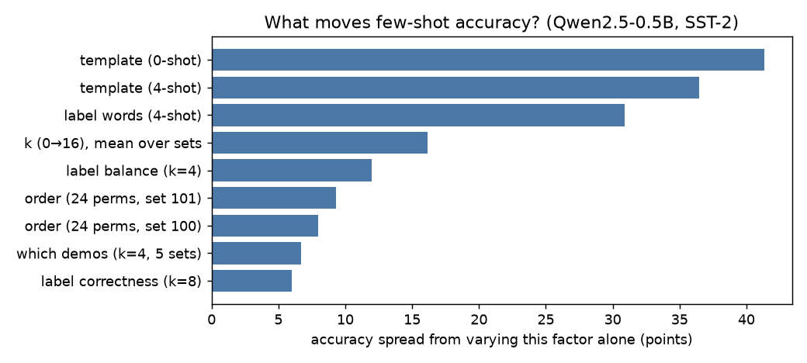
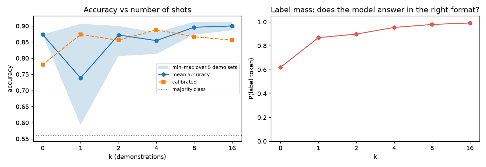
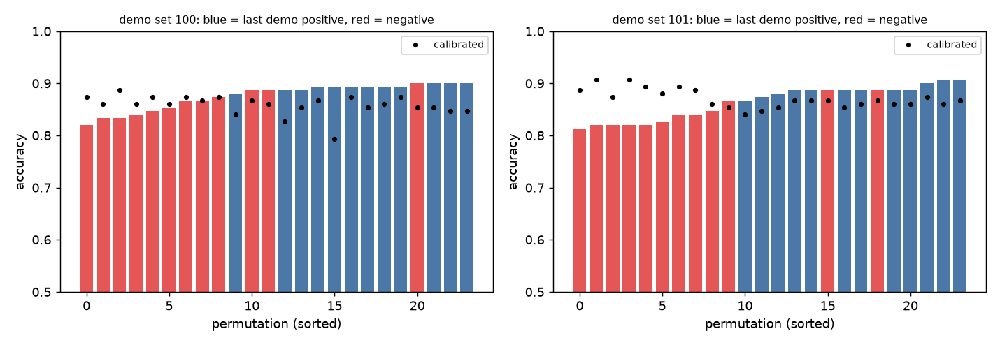
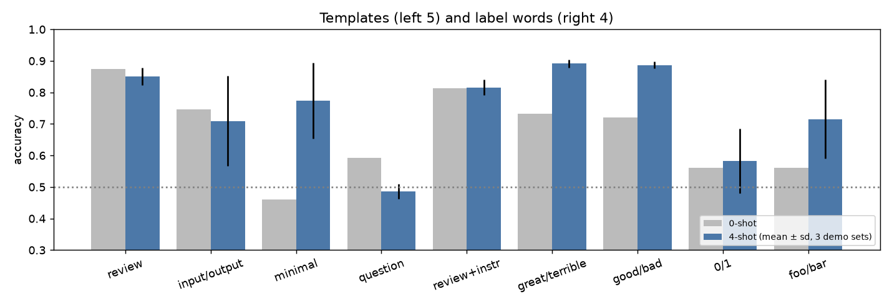
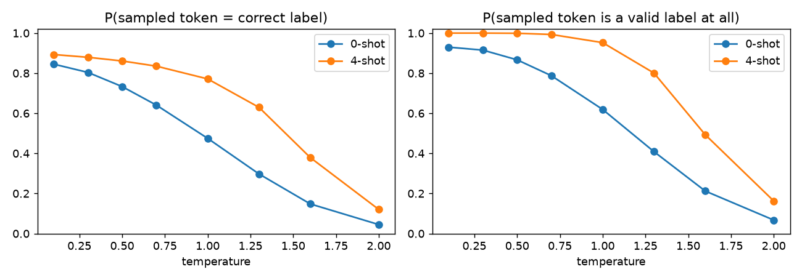
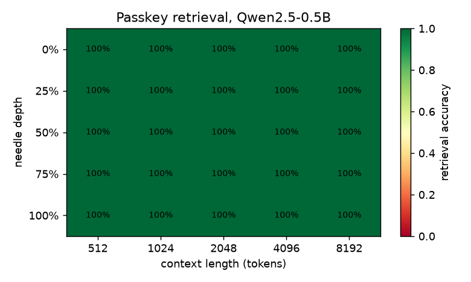

# Week 2: Context, Sampling and In-Context Learning

| | |
|---|---|
| **Topics** | Temperature, top-p, top-k, context window limits, why few-shot prompting works |
| **Paper** | *Language Models are Few-Shot Learners* (Brown et al., 2020), [arXiv:2005.14165](https://arxiv.org/abs/2005.14165) |
| **Task** | Systematically vary few-shot examples (count, order, format) on a fixed task and document what actually moves output quality |
| **Notebook** | [`jupyter/week2_in_context_learning.ipynb`](../../jupyter/week2_in_context_learning.ipynb) |
| **Code** | [`src/icl.py`](../../src/icl.py): formats, demo sampling, KV-cached scoring, calibration |
| **Raw results** | `results/week2/` (`icl_runs.jsonl` = 140 runs, `passkey.json`, all charts) |
| **Further reading** | [resources.md](resources.md) · **Articles plan:** [articles/](articles/README.md) |

---

## 0. Setup

| Item | Choice | Why |
|---|---|---|
| Model | **Qwen2.5-0.5B (base)** | GPT-3's paper studies ICL in *base* models. Instruction tuning would hide the effects. Small enough for CPU |
| Task | **SST-2** binary movie-review sentiment | The classic ICL benchmark used by Zhao et al., Lu et al. and Min et al., so results are comparable |
| Test set | 150 fixed dev reviews (49% positive, majority baseline 51%) | Same 150 in every run, so differences come from the prompt alone |
| Demo pool | SST-2 train sentences of 5–40 words | Keeps prompts short |
| Scoring | Compare log P(`' positive'`) vs log P(`' negative'`) at the answer position | Deterministic (no sampling noise). Same as GPT-3's classification evals |
| Extra metrics | **calibrated accuracy**, **positive-prediction rate**, **label mass** | See below |
| Speed trick | Encode the shared few-shot prefix **once**, reuse its KV cache for all 150 queries | Verified exact (max difference 1e-5). Made ~140 configs feasible on a laptop |

**Metrics explained**
- **Label mass** = P(`' positive'`) + P(`' negative'`) over the *full* 151k-token vocabulary. It measures whether the model even answers in the right format.
- **Positive-prediction rate** = fraction of test reviews predicted positive. The truth is 49%; large deviations mean bias.
- **Contextual calibration** (Zhao et al., 2021) = also score the content-free input `"N/A"`, then subtract its log-probs. This removes the prompt's built-in bias toward one label.

### Environment notes
- `datasets` couldn't be installed on this stack (it pulls a `tokenizers` version that fails to build), so the data is downloaded as raw JSONL with `huggingface_hub`.
- **Tokenisation gotcha:** Qwen tokenises digits one at a time, so `' 0'` = `' '` + `'0'`. For the `0/1` label format the space must stay **in the prompt**, the *opposite* of GPT-2's rule from Week 1. `Format(space_in_query=True)` handles this. Always check how your model tokenises its labels.

---

## 1. The paper in one page: GPT-3 (Brown et al., 2020)

| Concept | What it means |
|---|---|
| **In-context learning (ICL)** | The model picks up a task from examples **in the prompt**, with no gradient updates. "Learning" happens in the forward pass |
| **Zero-shot / one-shot / few-shot** | 0, 1 or K demonstrations (K typically 10–100, "as many as fit in the 2,048-token window") plus a natural-language task description |
| **Main claim** | ICL ability **grows with scale**. The gap between zero-shot and few-shot widens with model size (Fig. 1.2). 175B parameters made few-shot competitive with fine-tuning on some tasks |
| **Meta-learning framing** | Pre-training = an "outer loop" over many implicit tasks. The prompt = an "inner loop" that identifies which task is being asked |
| **Limits (from the paper)** | Weak on some comparison and NLI tasks; unclear whether ICL learns *new* tasks or *recognises* ones seen in training; data contamination concerns; expensive to run |

Why few-shot prompting works, according to later research (this week's experiments test several of these):
1. **Demos specify the format and label space** (Min et al., 2022). Confirmed: label mass goes from 0.62 to 0.99.
2. **Demos locate the task** (Bayesian view, Xie et al., 2021). The model already "knows" sentiment; demos tell it which task this is.
3. **Bigger models can actually learn input→label mappings** (Wei et al., 2023). Small ones mostly can't. Confirmed: flipped labels barely moved our 0.5B model.
4. **Mechanism:** induction heads copy patterns from earlier in the context (Olsson et al., 2022), which links back to Week 1's attention work.

---

## 2. Results

### Headline: what actually moves accuracy

Spread in accuracy (max − min) from varying **one** factor at a time:

| Rank | Factor | Spread | Verdict |
|---|---|---|---|
| 1 | **Prompt template** | **36–41 pts** | Matters most by far |
| 2 | **Label words** | **31 pts** | Matters a lot |
| 3 | Number of shots k (0→16) | 16 pts | Mostly from the bad 1-shot case |
| 4 | Label balance in demos | 12 pts | Creates predictable bias |
| 5 | Demo order | 8–9 pts | Real, but smaller than expected |
| 6 | Which demos (random sets) | 7 pts | Small |
| 7 | **Label correctness** | **6 pts** | Hardly matters (!) |

**Main conclusion: *how* you format the prompt matters about 5× more than *which* examples you pick, what order they're in, or even whether their labels are correct.**

---

### E1: Number of shots

| k | Accuracy (mean of 5 demo sets) | Worst set | Best set | Label mass | Prompt tokens |
|---|---|---|---|---|---|
| 0 | 0.873 | — | — | **0.62** | 0 |
| **1** | **0.739** | **0.593** | 0.907 | 0.87 | 28 |
| 2 | 0.872 | 0.807 | 0.900 | 0.90 | 54 |
| 4 | 0.855 | 0.813 | 0.880 | 0.95 | 106 |
| 8 | 0.896 | 0.873 | 0.913 | 0.98 | 243 |
| 16 | **0.900** | 0.887 | 0.913 | **0.99** | 484 |

- **One-shot is worse than zero-shot** (0.74 vs 0.87, and as low as 0.59). One demo pulls predictions toward its own label; calibration recovers it to 0.87.
- **More shots mainly reduce variance:** the std across demo sets drops from 0.104 (k=1) to 0.009 (k=16). The mean only goes from 0.87 to 0.90.
- **Label mass rises from 0.62 to 0.99.** Zero-shot, 38% of the probability goes to tokens that *aren't valid answers*. This is the clearest evidence that demos mostly teach **format**.
- Each SST-2 demo costs about 29 tokens: around 71 demos fit in GPT-3's 2,048 window and about 1,148 in Qwen's 32k.

### E2: Order (all 24 permutations of the same 4 demos, two demo sets)

| Demo set | Mean acc | Range across orderings | Calibrated range |
|---|---|---|---|
| 100 | 0.876 ± 0.024 | **0.820 – 0.900** | 0.793 – 0.887 |
| 101 | 0.864 ± 0.031 | **0.813 – 0.907** | 0.840 – 0.907 |

- Same demos, different order → an **8–9 point swing**.
- **Recency bias:** when the *last* demo is positive, the model predicts positive 57% of the time, against 47% when the last demo is negative (a 10-point shift; the truth is 49%).
- Best order `[+ − − +]` (0.900) vs worst `[− + + −]` (0.820).
- Smaller than the "near random to near SOTA" swings in Lu et al. (2021). Their bigger effects came with GPT-2/GPT-3-sized models on harder tasks. SST-2 is easy for this model.
- Calibration made results *more consistent* (lower std) but didn't always raise the mean.

### E3: Format (template and label words)

| Format | 0-shot | 0-shot label mass | 4-shot (mean ± sd) | 4-shot calibrated |
|---|---|---|---|---|
| `Review: … Sentiment: positive` | **0.873** | 0.62 | 0.851 ± 0.028 | 0.880 |
| `Input: … Output: positive` | 0.747 | 0.00 | 0.709 ± 0.143 | 0.780 |
| `… \n positive` (minimal) | 0.460 | 0.00 | 0.773 ± 0.120 | 0.860 |
| `Text: … Question: positive or negative? Answer:` | 0.593 | 0.05 | **0.487** ± 0.024 | 0.778 |
| `Review` + instruction | 0.813 | 0.15 | 0.816 ± 0.025 | 0.856 |
| labels `great / terrible` | 0.733 | 0.00 | **0.891** ± 0.013 | 0.871 |
| labels `good / bad` | 0.720 | 0.00 | 0.887 ± 0.011 | 0.804 |
| labels `1 / 0` | 0.560 | 0.43 | 0.582 ± 0.102 | 0.560 |
| labels `foo / bar` (arbitrary) | 0.560 | 0.00 | 0.716 ± 0.125 | 0.440 |

- **The "question" template scores *below chance* (0.487) with 4 shots.** It predicts **negative 97% of the time**. The template literally ends with "…positive or negative?", so "negative" is the most recent label word. That matches the *recency / common-token bias* in Zhao et al. Calibration rescues it to 0.73–0.87.
- **Natural label words win:** `great/terrible` (0.891) and `good/bad` (0.887) beat `positive/negative` (0.851) with 4 shots.
- **Arbitrary symbols partly work:** `foo/bar` goes from 0.56 to 0.72 with 4 demos, so the model *does* pick up a new mapping from 4 examples. But it's unstable (0.56–0.87 across demo sets).
- **Digits barely work** (`1/0`: 0.58). The numbers carry no sentiment prior.
- **Adding an instruction didn't help** this base model (0.816 vs 0.851). Base models respond to *patterns*, not instructions.
- **Calibration fails for arbitrary labels** (`foo/bar`: 0.72 → 0.44). The "N/A" baseline can't measure bias toward meaningless words. Calibration is not a free win.

### E4: Do the demo labels need to be correct? (k = 8, 5 demo sets)

| Demo labels | Accuracy |
|---|---|
| Gold (correct) | 0.896 ± 0.016 |
| **Random** | **0.884** ± 0.029 (−1.2 pts) |
| **Flipped** (all wrong) | **0.836** ± 0.031 (−6.0 pts) |
| (zero-shot reference) | 0.873 |

- **Replicates Min et al. (2022):** random labels cost only about 1 point. Demos teach *format and label space*, not the mapping.
- **Replicates Wei et al. (2023):** with *every* label flipped, a 0.5B model still gets 84% right. It **ignores the demos' mapping and follows its prior**. In their study only the largest models (e.g. PaLM-540B) overrode their priors and followed the flipped labels.

### E5: Label balance (k = 4)

| Positive demos | Accuracy | Calibrated | Predicted-positive rate |
|---|---|---|---|
| 0/4 | 0.762 | 0.893 | 0.33 |
| 1/4 | 0.820 | 0.887 | 0.41 |
| 2/4 | 0.851 | 0.880 | 0.47 |
| 3/4 | 0.882 | 0.847 | 0.57 |
| 4/4 | 0.847 | 0.811 | 0.67 |

- **Majority-label bias is almost linear:** each extra positive demo adds about 8 points to the predicted-positive rate (from 33% to 67%).
- Calibration fixes the all-negative case (0.76 → 0.89) but *hurts* when the demos are positive-heavy.

---

## 3. Sampling meets ICL

What's P(the *sampled* token is the correct label), sampling from the full vocabulary? (50 test reviews.)

| Setting | 0-shot | 4-shot |
|---|---|---|
| T = 0.1 (almost greedy) | 0.845 | 0.893 |
| T = 1.0 | **0.475** | **0.771** |
| T = 1.0, top-k = 40 | 0.513 | 0.777 |
| T = 1.0, top-p = 0.9 | 0.520 | 0.817 |

- **Zero-shot at T=1 is a coin flip (0.475)**, mostly because the model samples tokens that aren't labels at all.
- **Few-shot makes sampling robust:** demos concentrate probability on the label tokens, so even T=1 keeps 77%.
- **Top-p helps more than top-k here** (+4.6 vs +0.6 pts at 4-shot). Top-p cuts the tail *adaptively*, while top-k=40 keeps 40 tokens even when only 2 matter.
- Practical rule: **for classification or extraction, use T≈0** or constrain outputs to the label set. Sampling only adds noise.

---

## 4. Context-window limits

| Test | Result |
|---|---|
| GPT-2, 1,024 tokens | OK |
| GPT-2, **1,025 tokens** | `IndexError: index out of range`. Its learned position table (`wpe`) has exactly 1,024 rows |
| Qwen2.5-0.5B | `max_position_embeddings = 32,768`. RoPE has no table, but quality outside the trained length isn't guaranteed |
| **Passkey retrieval**, 512 → 8,192 tokens × 5 depths × 2 seeds | **50/50 = 100%** at every length and depth |

**An honest null result.** No "lost in the middle" effect up to 8k tokens. Why:
- A passkey test is an **exact-match copy task**: find "passkey is 79680", copy it. That's exactly what the induction heads from Week 1 do well.
- Our needle said the key **twice**, which made it easier still.
- *Lost in the Middle* and *RULER* use harder tasks: multi-document QA, multiple needles, aggregation, distractors. **Effective context ≪ claimed context** shows up there, not on passkey tests.
- Cost grows quickly: 512 tokens took ~3 s, 8,192 tokens took ~4 minutes on this CPU (prefill cost grows with length, attention quadratically).

---

## Key takeaways

1. **Format beats everything.** Template and label words moved accuracy 31–41 points. Order, demo choice and label correctness moved it 6–9.
2. **Demos teach the format more than the task.** Label mass goes 0.62 → 0.99, and random labels cost only about 1 point.
3. **Small models follow their prior, not your demos.** Flipped labels still give 84%.
4. **ICL has predictable biases:** recency (last demo), majority label, and the most recently mentioned label word. A template ending in "positive or negative?" collapsed onto "negative" 97% of the time.
5. **Calibration is a tool, not a fix.** It rescued biased prompts (0.49 → 0.87) but hurt with arbitrary labels (0.72 → 0.44).
6. **One-shot can be worse than zero-shot.** Use several balanced shots, or none.
7. **Sampling + zero-shot = noise.** Few-shot makes outputs robust to temperature; for classification just use T≈0.
8. **"Fits in the context" ≠ "uses the context".** Passkey retrieval was perfect to 8k, but that test is too easy to show it.

## Open questions / next experiments

- [ ] Repeat E2–E4 with **Qwen2.5-1.5B** or **3B**. Does flipped-label following appear with scale?
- [ ] **Retrieval-selected demos** (nearest neighbours by embedding, Liu et al. 2021) vs random. Does it beat the 7-point "which demos" spread?
- [ ] A harder long-context test: multi-needle or "lost in the middle"-style QA, instead of passkey.
- [ ] Try a harder task where the model is near 60% zero-shot (e.g. a 5-class task like SST-5), where order effects should be larger.
