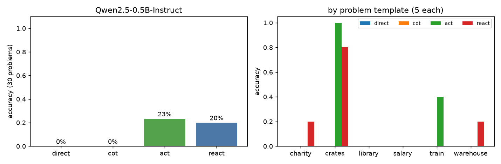
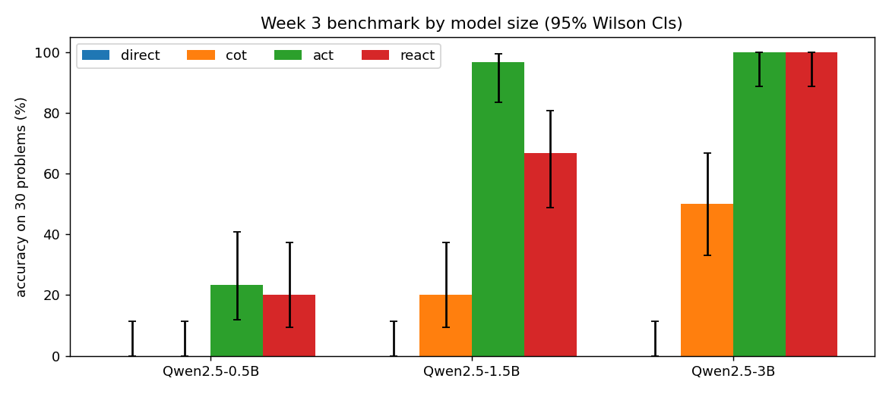

# Week 3: Reasoning and Tool-Use Foundations

| | |
|---|---|
| **Topics** | Interleaved reasoning and action, minimal agent loops |
| **Paper** | *ReAct: Synergizing Reasoning and Acting in Language Models* (Yao et al., 2022), [arXiv:2210.03629](https://arxiv.org/abs/2210.03629) |
| **Task** | Hand-implement a minimal single-tool ReAct-style loop on a small task |
| **Agent code** | [`src/react_agent.py`](../../src/react_agent.py): calculator tool, prompts, LLM wrapper, loop. No framework |
| **Notebook** | [`jupyter/week3_react_agent.ipynb`](../../jupyter/week3_react_agent.ipynb) |
| **Raw results** | `results/week3/runs.jsonl` (120 runs with full trajectories), `accuracy_by_mode.png` |
| **Further reading** | [resources.md](resources.md) · **Articles plan:** [articles/](articles/README.md) |

Try the agent on any question:
```bash
uv run python src/react_agent.py "A truck carries 1,284 boxes with 36 cans each. 2,050 are damaged. How many good cans?"
```

---

## 1. The paper in one page: ReAct (Yao et al., 2022)

| | Reason only (CoT) | Act only | **ReAct** |
|---|---|---|---|
| Trajectory | Thought → Thought → Answer | Action → Observation → Action → … | **Thought → Action → Observation → Thought → …** |
| Strength | Plans, decomposes | Grounded in real data from tools | Both |
| Weakness | **Hallucinates** facts and arithmetic; can't check itself | No planning; can't track progress or recover | Longer and slower; format errors; can loop |

- **Tasks in the paper:** HotpotQA and FEVER (with a Wikipedia `search`/`lookup` API), plus ALFWorld and WebShop (interactive environments).
- **Method:** few-shot prompting (a handful of human-written trajectories). No training, except a fine-tuning study on smaller PaLMs.
- **Key results:**
  - ReAct beats Act-only on every task, so the thoughts matter.
  - On QA, the best results come from **combining** ReAct with CoT-SC (switching between them when one is unsure).
  - On ALFWorld/WebShop, ReAct beats imitation and RL baselines by a large margin (+34% / +10% absolute success).
- **The paper's own failure analysis (HotpotQA):** CoT mostly failed by **hallucination**. ReAct mostly failed through **reasoning errors**: repetitive loops, and uninformative search results that derailed it.
- **Scale:** with prompting alone, ReAct worked well only with **large** models (PaLM-540B). Small models (PaLM-8B) did poorly unless fine-tuned on ReAct trajectories. Our results below show the same.

### Why this matters
ReAct is the **ancestor of every modern agent**: Claude/GPT tool use, coding agents, browser agents. Native "tool calling" APIs are this loop with structured JSON in place of the text `Action: name[args]`, and the provider's stop logic in place of our `stop=["Observation:"]`.

---

## 2. What was built

### The loop (the whole agent)
```
trajectory = ""
for step in 1..max_steps:
    text = LLM(system_prompt + question + trajectory, stop=["Observation:"])   # model writes Thought + Action
    trajectory += text
    parse "Action: name[arg]"
    if finish  -> return arg
    if calculate -> obs = calculator(arg)                                        # OUR code runs the tool
    else -> obs = "Invalid action ..."                                           # errors become observations
    trajectory += "Observation: " + obs
```

### Design decisions

| Decision | Why |
|---|---|
| `stop=["Observation:"]` | Hands control back to our code exactly where the model would otherwise **invent** the tool result. The notebook shows the model writing its own fake `Observation:` when the stop is removed |
| Safe AST calculator, **never `eval()`** | Model output is untrusted. `__import__('os').system('rm -rf ~')` → error, `2**100000` → error. Errors are *returned as observations* so the agent can recover |
| Tool errors are helpful messages | "Use only numbers and + - * / ( )". This follows Anthropic's tool-writing advice: an error should tell the model how to fix it |
| Few-shot exemplars (2 hand-written trajectories) | Same approach as the paper. The exemplars define the format |
| Assistant turn pre-filled with the trajectory | The chat template is rendered, then the trajectory is appended as an *open* assistant message for the model to continue |
| `max_steps = 6` | Prevents infinite loops (one of the paper's failure modes) |
| Same exemplar problems in all 4 modes | A fair ablation: only the trajectory *format* differs |

### The task
30 synthetic two-step word problems (6 templates × 5) with **big numbers**, e.g. *"A warehouse stores 7,511 boxes with 77 items in each box. It ships out 1,331 items. How many items are left?"* → 7511 × 77 − 1331 = **577,016**. The arithmetic is too hard to do mentally, so success requires the right *plan* plus the tool.

### Model
**Qwen2.5-0.5B-Instruct** on CPU, greedy decoding. (Qwen2.5-1.5B-Instruct generated at only about 1.3 tokens/s on this Intel CPU, too slow for 120 multi-step episodes. See *next experiments*.)

---

## 3. Results



| Mode | Accuracy | LLM calls | Tool calls | Tokens in | Tokens out | Seconds / problem |
|---|---|---|---|---|---|---|
| Direct answer | **0%** (0/30) | 1.0 | 0 | 160 | 10 | 7 |
| CoT (reason only) | **0%** (0/30) | 1.0 | 0 | 250 | 83 | 19 |
| Act only | **23%** (7/30) | 2.8 | 1.0 | 1,110 | 132 | 73 |
| **ReAct** | **20%** (6/30) | 2.9 | 1.8 | 1,443 | 126 | 58 |

### Finding 1: the tool is what makes any progress possible
Without a calculator: 0/60. With one: 13/60. The paper's main CoT failure, **hallucination**, shows up here as arithmetic hallucination:
> CoT: "606 km/day × 42 days = **25,592** km" (the true value is 25,452)

### Finding 2: errors look completely different with and without the tool
| Mode | Median relative error of wrong answers |
|---|---|
| CoT | **4.9%**: right plan, wrong arithmetic (near misses) |
| Act / ReAct | **89–97%**: exact arithmetic, *wrong plan* |

The tool **moves the failure from computation to planning**. That mirrors the paper's analysis: CoT fails by hallucination, ReAct by reasoning errors.

### Finding 3: at 0.5B, ReAct ≈ Act (the thoughts didn't help)
20% vs 23% is a 1-problem difference, i.e. a tie. Typical ReAct failures:
- **Dropped a quantity:** *"pays each of its 140 employees $4,584 per month… 10 months"* → `calculate[4584 * 10]`. The 140 employees are lost.
- **Misread the structure:** *"577 km each day for 46 days, then another 647"* → `calculate[577 + 647]`.
- **Ignored the observation (3/30):** the tool correctly returned `577016`, then the model's Thought subtracted 1,331 *again* and answered `575685`. The reasoning step *overrode* the ground truth.

This matches the paper: **prompted ReAct needs a large model.** PaLM-8B did poorly with prompting alone too. The thoughts are only as good as the model writing them.

### Finding 4: success = copying the exemplar's plan
Almost all successes are on the **crates** template (Act 5/5, ReAct 4/5): *"packs N apples into crates of B, each crate sells for $C"*. That has **exactly the same structure as exemplar 2** (bolts into bags, $7 per bag). On templates that don't match an exemplar, accuracy is close to 0.

The model isn't reasoning about these problems; it's **pattern-matching the demos**. This is Week 2's lesson again: few-shot examples teach the format and the *plan shape*.

### Finding 5: agents cost more
ReAct used **~9× the input tokens** of direct answering (1,443 vs 160) and ~3 LLM calls per problem, because the whole prompt is re-sent on every step. Production systems use prompt caching to cut this cost (the same KV-cache idea as Weeks 1–2).

### Finding 6: stop sequences in action
Without `stop=["Observation:"]`, the model wrote `Observation: 45840` **itself** after `calculate[4584 * 10]`. It happened to be right because the multiplication was trivial, but it's a guess, not a tool result. On large numbers those guesses are wrong (see CoT). The stop sequence is the boundary between *the model* and *the world*.

---

## Key takeaways

1. **An agent is a loop, a parser and a stop sequence.** About 100 lines, no framework needed. Frameworks add retries, memory, structured tool calling and tracing, but this is the core.
2. **Tools change *how* models fail, not just how often.** Near-miss arithmetic errors (5%) became wrong-plan errors (90%+).
3. **Reasoning traces need a capable model.** At 0.5B, thoughts didn't beat act-only, and once a thought even overrode a correct tool result. This matches the paper's scale finding.
4. **Few-shot exemplars define the agent's competence.** It solved the problem shape it was shown and little else. Exemplar coverage matters as much as the model.
5. **Treat model output as untrusted.** Never `eval`. Return errors as observations so the agent can recover.
6. **Agents are expensive.** About 9× the tokens and 3× the calls. Use them only when a single call can't do the job (Anthropic's *Building Effective Agents*).

## Next experiments
- [ ] **Scale:** run all four modes with **Qwen2.5-1.5B** and **3B** on a free GPU with [`jupyter/week3_colab.ipynb`](../../jupyter/week3_colab.ipynb) (see "Running Week 3 on a GPU" below). Does ReAct pull ahead of Act once the model can plan?
- [ ] **Exemplar coverage:** add a third exemplar matching the "salary" (3-factor product) shape. Does that template jump from 0%?
- [ ] **Self-consistency:** sample 5 ReAct trajectories at T=0.7 and vote on the answer.
- [ ] **Native tool calling:** reimplement with an API's structured tool use (JSON tool calls) and compare format-error rates.
- [ ] **A second tool:** add `lookup[city]` (a tiny dict) to make problems that need facts *and* arithmetic, closer to the paper's HotpotQA setting.

---

## Why Was Qwen Failing?

Three separate problems, and the evidence points to each one.

**1. It can't do big arithmetic in its head (Direct and CoT: 0/30).** Multiplying a 4-digit number by a 2-digit one is beyond a 0.5B model. With chain-of-thought it usually had the right plan and the wrong numbers: "7,511 × 77 = 559,887" when the truth is 578,347. Its wrong answers were only 4.9% off on average. The calculator exists to fix exactly this, and it did: no tool-using run made an arithmetic error.

**2. It can't reliably turn the question into an expression (most Act and ReAct failures).** Once arithmetic was exact, the remaining failures were planning failures:

| Failure | Act | ReAct | Example |
|---|---|---|---|
| Wrong plan or expression | 19 | 21 | "140 employees × $4,584 × 10 months" became `4584 * 10`; "577 km a day for 46 days, then 647 km" became `577 + 647` |
| Ignored the tool's answer | 0 | 3 | The calculator returned 577016, then the Thought subtracted 1,331 again |
| Hit the 6-step limit | 3 | 0 | |
| Answered without the tool | 1 | 0 | |

Dropping a quantity or picking the wrong operation is a reading-comprehension limit of a model this small, and the Thought lines didn't fix it. Sometimes they made it worse, by re-doing arithmetic the tool had already done correctly.

**3. It copied the examples instead of reasoning.** Almost every success came from the "crates" template, which has the same shape as the second prompt example (divide, then multiply by a price): 9 of 10 across Act and ReAct, against 4 of 50 on the other templates. For ReAct alone that is 4 of 5 against 2 of 25 (Fisher exact p = 0.015 in the Week 4 audit). The model matched the pattern it was shown.

**What this predicts:** a model that reads better (1.5B, 3B) should fix problem 2 first. If ReAct's Thought lines then start helping with planning, the ReAct vs Act gap should open up with size. That's what the Colab run tests.

## GPU Results: 1.5B and 3B (Colab, 16 October 2026)

Run on a free Colab T4 with [`jupyter/week3_colab.ipynb`](../../jupyter/week3_colab.ipynb): the same 30 problems, four modes, greedy decoding. Raw results: `results/week3_gpu/`.



| Model | Direct | CoT | Act-only | ReAct | ReAct − Act (95% CI) | McNemar p | Tokens ReAct / Act |
|---|---|---|---|---|---|---|---|
| 0.5B (laptop) | 0% | 0% | 23% | 20% | −3.3 (−16.7 to +10.0) | 1.000 | 1.26× |
| 1.5B | 0% | 20% | **97%** | **67%** | **−30.0 (−50.0 to −13.3)** | **0.012** | 1.43× |
| 3B | 0% | 50% | **100%** | **100%** | 0 (ceiling) | 1.000 | **1.89×** |

**My prediction was wrong.** I expected the Thought lines to start helping once the model could read the problem. Instead:

1. **The tool did almost all the work.** Act-only went from 23% to 97% to 100% with size. Once a model can write the right expression, a calculator plus a terse action format is enough.
2. **At 1.5B, ReAct is significantly worse than Act-only** (−30 points, p = 0.012; Act won 10 of the 11 problems where they disagreed). Every ReAct failure came from two templates, 5 of 5 each:
   - **Train:** the Thought restated the question as "add the first part and the second part", dropped "for 46 days", then executed the wrong plan correctly (`577 + 647`). Act-only wrote `577 * 46 + 647` straight away.
   - **Library:** the Thought wrote a numbered three-step plan, after which the model invented tools that don't exist (`add[...]`, `subtract[...]`), fired several actions without waiting for observations, and did arithmetic in its head (7,004 + 1,612 written as 18,616).

   In both cases the reasoning trace introduced the error.
3. **At 3B, both reach 100%, but ReAct costs 1.89× the tokens.** It fails the protocol's cost bound (≤ 1.5×), and on a cost-accuracy plot Act-only dominates it, exactly as Kapoor et al. warn.
4. **CoT improves with size but stays unreliable** (0% → 20% → 50%). At 3B its errors are still arithmetic slips ("577 × 46 = 26,402"; the truth is 26,542).

**What this means:** on this task, the paper's claim (reasoning traces improve tool use) doesn't hold for small prompted models. At 1.5B the traces hurt, and at 3B there's no headroom left to show a benefit. The task is too easy for Act-only once the model can read it. A fair test needs harder problems: more steps, distractor numbers, and templates the prompt never showed. The Week 4 protocol has been amended accordingly.

**Caveats:** 30 problems from 6 templates, so per-template effects dominate (the 1.5B gap is two templates failing completely). One run, greedy decoding, one model family. The exemplars match two of the test templates' shapes.

## Running Week 3 on a GPU

The laptop CPU generates about 1.3 tokens/s with the 1.5B model, too slow for 120 agent runs. A free GPU makes it practical.

| Platform | GPU | Free quota | How |
|---|---|---|---|
| **Google Colab** (recommended) | T4, 16 GB | Free tier, session limits vary | Open [`jupyter/week3_colab.ipynb`](../../jupyter/week3_colab.ipynb) from GitHub, `Runtime → Change runtime type → T4 GPU`, `Run all` |
| **Kaggle Notebooks** | T4 ×2 or P100 | About 30 GPU hours a week | Import the same notebook; turn on GPU and Internet in Settings |
| Any GPU machine (Lightning AI, RunPod, a lab server) | Any CUDA GPU | Paid or credits | `git clone` the repo, `pip install "transformers==4.49.0" accelerate`, then `python src/run_react_bench.py --model Qwen/Qwen2.5-3B-Instruct` |

What runs where:
- [`src/run_react_bench.py`](../../src/run_react_bench.py) runs the four modes for one model on the same 30 problems (from [`src/react_tasks.py`](../../src/react_tasks.py)), saving each result as it goes, so an interrupted run resumes.
- The agent picks the GPU automatically, in bf16 or fp16.
- The notebook saves results to Google Drive, then compares 0.5B, 1.5B and 3B with confidence intervals and a paired ReAct vs Act test.
- Bring the results back by downloading the zip into `results/week3_gpu/` and committing them.

Remember the Week 4 lesson: 30 problems can only detect large gaps (about 15 to 20 points). Treat this run as a pilot; its discordance number sizes the full protocol in [`notes/week_4/eval_protocol.md`](../week_4/eval_protocol.md).
