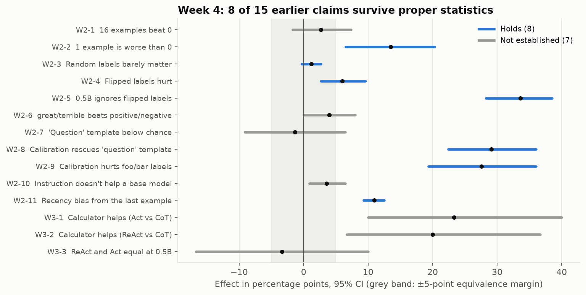
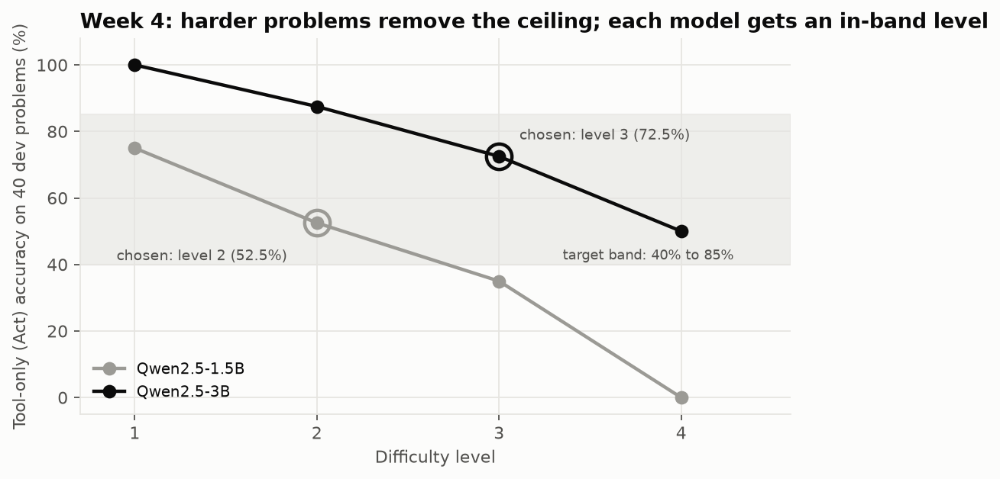
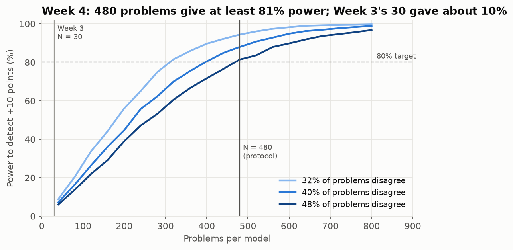
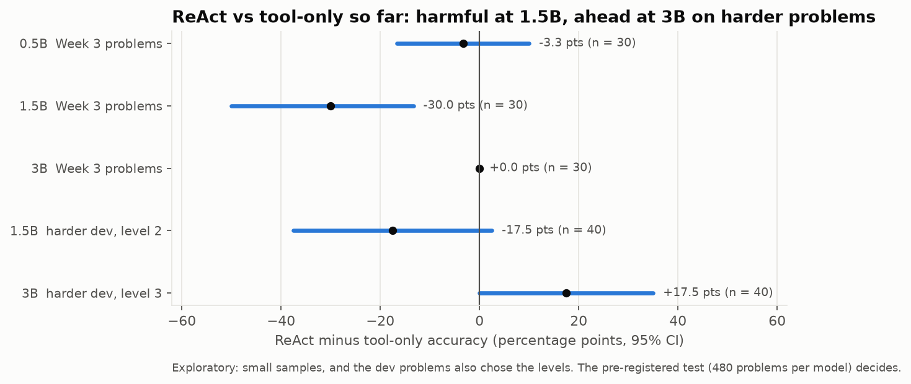

# Week 4: Research Methodology for Applied AI

**Paper:** [AI Agents That Matter](https://arxiv.org/abs/2407.01502) (Kapoor et al., TMLR 2025)
**Lab:** design, on paper, an eval protocol for a specific claim, with explicit success and failure criteria.
**Deliverables:** [frozen protocol](../../protocol/README.md) · [rigour memo](rigour_memo.md) · [Phase 1 log](../phase_1_log.md)
**Notebooks:** [`week4_rigour_audit.ipynb`](../../jupyter/week4_rigour_audit.ipynb) (no models, 2 minutes) · [`week4_calibration_colab.ipynb`](../../jupyter/week4_calibration_colab.ipynb) · [`week4_test_run_colab.ipynb`](../../jupyter/week4_test_run_colab.ipynb)
**Code:** [`src/stats.py`](../../src/stats.py) · [`src/react_tasks_v2.py`](../../src/react_tasks_v2.py) · [`src/protocol_analysis.py`](../../src/protocol_analysis.py)

## The paper in brief

| Problem | Evidence | Fix |
|---|---|---|
| Accuracy reported without cost | A retry-with-rising-temperature baseline scored 93.2% on HumanEval for $2.45; LATS scored 88.0% for $134.50 | Plot accuracy against cost; keep the Pareto frontier |
| Missing holdouts | Few of 17 agent benchmarks had holdouts matched to the claim; 7 had none | Hold out at the claim's generality level (task-specific claims need unseen problem shapes) |
| No standardisation | Agents scored on different subsets; results not reproducible | Shared harnesses, repeated runs, confidence intervals |

## Audit of Week 2 and 3 Claims

15 claims re-tested with paired tests, 95% confidence intervals, a ±5-point equivalence margin for "no difference" claims, and Holm correction across claims. **8 hold, 7 are not established, 0 are overturned.** Full table: [`results/week4/claim_audit.json`](../../results/week4/claim_audit.json).

| Check | Result |
|---|---|
| Week 3 sample size | 30 problems had 10% power to detect a 10-point difference |
| Winner's curse | Best-vs-worst prompt ordering: reported 8.0 and 9.3 points; measured on held-out halves, 4.8 and 6.7 (28% to 40% smaller) |
| Cost vs accuracy (Week 3, 0.5B) | ReAct used 26% more tokens than Act-only for no gain: dominated |

## The Protocol

**Claim:** at 1.5B and 3B, ReAct solves at least 10 points more held-out multi-step calculator problems than Act-only, at no more than 1.5× the tokens.

It went through four versions before freezing. Each change was made before any test problem was run:

| Version | Trigger | Change |
|---|---|---|
| 1.0 | Week 3 at 0.5B | Paired design, held-out templates, N = 300 |
| 1.1 | GPU pilot: Act-only 97% to 100% (ceiling) | Harder problems; "harmful" outcome; N = 400 |
| 1.2 | Calibration v1: no usable level; shuffling made text incoherent | Scene sentence first; 4 levels; per-model level rule |
| 1.3 | Calibration v2: levels chosen; 48% disagreement at 1.5B | 1.5B level 2, 3B level 3; N = 480 per model |

**Status:** frozen at v1.3 (commit `5e8ad76`, 16 October 2026). Test run pending (about 7.5 GPU hours).

## Exploratory signal (not the test)

On the 40 dev problems, ReAct trailed Act-only by 17.5 points at 1.5B and led by 17.5 at 3B. The dev set is small and also chose the levels, so only the held-out test can confirm this.

## Files

- Calibration data: [`results/week4_dev_v1/`](../../results/week4_dev_v1/), [`results/week4_dev_v2/`](../../results/week4_dev_v2/)
- Sources: [`sources.md`](sources.md) · Reading list: [`resources.md`](resources.md) · Article outlines: [`articles/`](articles/README.md)
