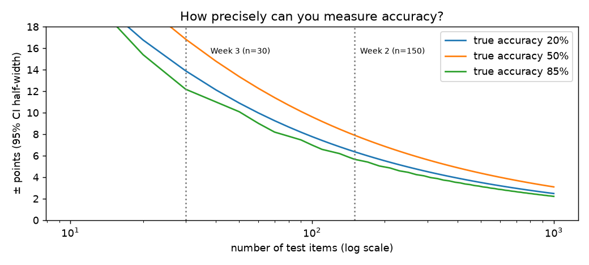
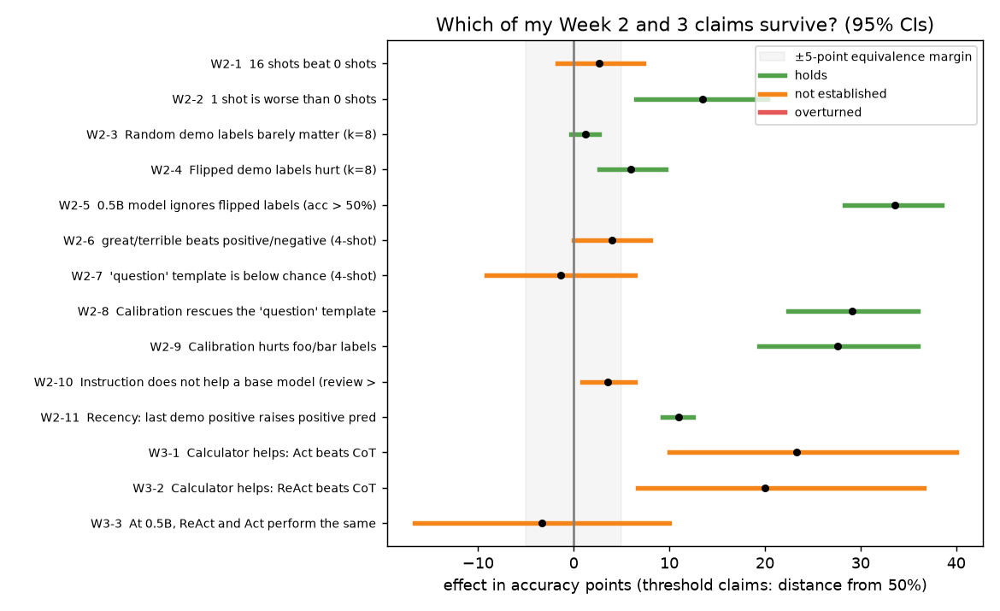
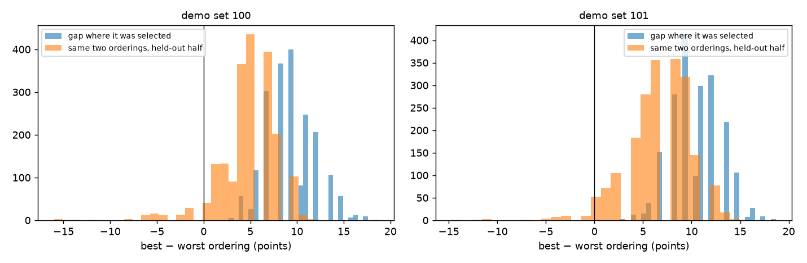
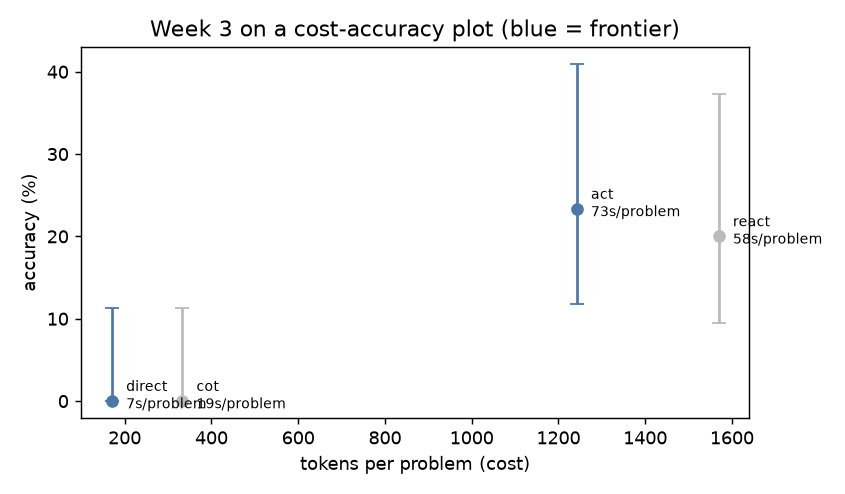
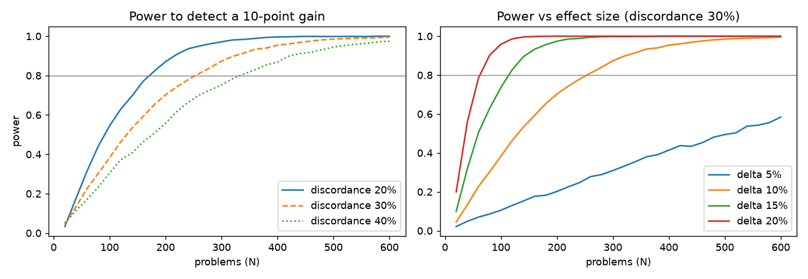

# Week 4: Research Methodology for Applied AI

| | |
|---|---|
| **Topics** | Hypothesis formation, experimental design, confounds, what "rigorous" means at small sample sizes |
| **Paper** | *AI Agents That Matter* (Kapoor, Stroebl, Siegel, Nadgir, Narayanan; TMLR 2025), [arXiv:2407.01502](https://arxiv.org/abs/2407.01502) |
| **Lab** | Design, on paper, an eval protocol for a specific claim, with explicit success and failure criteria |
| **Lab deliverable** | [eval_protocol.md](eval_protocol.md): does ReAct beat Act-only once the model can plan? |
| **Phase 1 deliverables** | [rigour_memo.md](rigour_memo.md) (how to evaluate a claim) and [../phase_1_log.md](../phase_1_log.md) (log of Weeks 1 to 4) |
| **Notebook** | [`jupyter/week4_rigour_audit.ipynb`](../../jupyter/week4_rigour_audit.ipynb). Runs in about 2 minutes; no models, only saved Week 2 and 3 results |
| **Code** | [`src/stats.py`](../../src/stats.py): Wilson CI, paired bootstrap, exact McNemar, sign-flip test, Fisher exact, Holm, power simulation |
| **Results** | `results/week4/`: `claim_audit.json`, `power_table.json`, five charts |
| **Further reading** | [resources.md](resources.md) · **Articles plan:** [articles/](articles/README.md) |

---

## 1. The paper in one page: *AI Agents That Matter*

Kapoor et al. analyse how AI agents are benchmarked and find four problems.

| Problem | Evidence in the paper | Recommendation |
|---|---|---|
| **Accuracy without cost** | On HumanEval, three simple baselines matched or beat complex agents. *Warming* (retry while raising temperature, GPT-4) scored 93.2% for $2.45; LATS scored 88.0% for $134.50, over 50× more | Plot accuracy against cost and compare Pareto frontiers. Jointly optimise both (their DSPy + Optuna version cut cost 41% to 53% on HotPotQA at the same accuracy) |
| **Model and downstream needs mixed up** | Active parameters used as a cost proxy mislead buyers. In the NovelQA case study, long-context models and RAG were roughly equally accurate, but RAG was far cheaper in realistic use | Report real dollar costs and token counts; keep model benchmarks separate from application benchmarks |
| **Missing holdouts** | Of 17 agent benchmarks, few had holdouts suited to their claimed generality, and 7 had none at all. Agents take shortcuts, such as hardcoding site-specific policies in WebArena | Match the holdout to the generality level: **distribution-specific** → in-distribution samples, **task-specific** → out-of-distribution samples, **domain-general** → unseen tasks, **general-purpose** → unseen domains |
| **No standardisation** | Agents evaluated on different subsets of HumanEval; reported accuracies above the maximum of the authors' 5 reproduction runs; a single SWE-bench run can cost over $8,000, so error bars are rare | Standard eval scripts, repeated runs with confidence intervals, shared harnesses |

**The follow-up, HAL** ([Holistic Agent Leaderboard](https://hal.cs.princeton.edu/), ICLR 2026): a shared harness that ran 21,730 rollouts across 9 models and 9 benchmarks (about $40,000). Among its findings: higher reasoning effort *lowered* accuracy in most runs, and log inspection caught agents searching for the benchmark's answers on HuggingFace instead of solving the task.

**Why it matters for this fellowship:** both specialisation paths end in evaluation. This paper is the checklist for not fooling yourself.

---

## 2. What I did

The lab asks for a protocol on paper. A protocol is only as good as its assumptions (effect size, variance, sample size), so I first took the claims from my own Weeks 2 and 3 and audited them with the statistics a protocol needs. All of it uses saved per-item results; no model was re-run.

### 2.1 How noisy is an accuracy score?

| Week 3 mode | Score | 95% Wilson CI |
|---|---|---|
| Direct | 0/30 = 0% | 0% to 11.4% |
| CoT | 0/30 = 0% | 0% to 11.4% |
| Act only | 7/30 = 23.3% | 11.8% to 40.9% |
| ReAct | 6/30 = 20.0% | 9.5% to 37.3% |

At n = 30, the intervals for Act and ReAct overlap almost completely. At n = 150 (Week 2), a score near 85% is still only known to about ±6 points.

### 2.2 Auditing 15 of my own claims

Method:
- **Paired tests** on the same items: exact McNemar for single 0/1 runs; paired bootstrap CI plus sign-flip permutation test when results are averaged over several demo sets.
- **"No difference" claims** need the whole 95% CI inside ±5 points.
- **Holm correction** across the 11 directional claims.

| ID | Claim (from my notes) | Effect | 95% CI | p (Holm) | Verdict |
|---|---|---|---|---|---|
| W2-1 | 16 shots beat 0 shots | +2.7 | −1.7 to +7.3 | 0.27 | **not established** |
| W2-2 | 1 shot is worse than 0 shots | +13.5 | +6.5 to +20.3 | 0.001 | holds |
| W2-3 | Random demo labels barely matter | +1.2 | −0.3 to +2.7 | (equivalence) | holds |
| W2-4 | Flipped demo labels hurt | +6.0 | +2.7 to +9.6 | 0.008 | holds |
| W2-5 | The 0.5B model ignores flipped labels (acc > 50%) | +33.6 above 50% | +28.3 to +38.5 | (threshold) | holds |
| W2-6 | great/terrible beats positive/negative | +4.0 | 0.0 to +8.0 | 0.12 | **not established** |
| W2-7 | The "question" template is below chance | −1.3 vs 50% | −9.1 to +6.4 | (threshold) | **not established** |
| W2-8 | Calibration rescues the "question" template | +29.1 | +22.4 to +36.0 | <0.001 | holds |
| W2-9 | Calibration hurts foo/bar labels | +27.6 | +19.3 to +36.0 | <0.001 | holds |
| W2-10 | An instruction doesn't help a base model | +3.6 | +0.9 to +6.4 | 0.08 | **not established** |
| W2-11 | Recency: a positive last demo raises positive predictions | +10.9 | +9.3 to +12.5 | <0.001 | holds |
| W3-1 | The calculator helps (Act > CoT) | +23.3 | +10.0 to +40.0 | 0.08 (raw 0.016) | **not established** |
| W3-2 | The calculator helps (ReAct > CoT) | +20.0 | +6.7 to +36.7 | 0.09 (raw 0.031) | **not established** |
| W3-3 | At 0.5B, ReAct and Act perform the same | −3.3 | −16.7 to +10.0 | (equivalence) | **not established** |
| W3-4 | ReAct successes concentrate on the exemplar-shaped template | +72.0 | (Fisher exact) | 0.015 | holds |

**8 hold, 7 are not established, 0 are overturned.** What I learned from the seven:
- **W2-1:** my headline "more shots help a little" is within noise. The robust k-effect was the *one-shot dip*, not the 16-shot gain.
- **W2-7:** "below chance" was too strong. 48.7% is indistinguishable from 50%. The robust finding is the *collapse onto one label* (97% "negative"), which calibration then fixes (W2-8).
- **W3-1, W3-2:** a 7-to-0 split looks decisive, and its raw p is 0.016. Corrected for testing 11 claims, it isn't significant at n = 30. The direction is almost certainly right; the evidence is thin.
- **W3-3:** "ReAct ≈ Act" is the clearest lesson. Failing to find a difference with 10% power tells you nothing. The interval allows ReAct to be 17 points worse or 10 points better.

### 2.3 The winner's curse

In Week 2 I reported the gap between the best and worst of 24 demo orderings. Choosing "best" and "worst" after seeing the scores selects for noise. Selecting on one random half of the items and measuring on the other half (2,000 splits):

| Demo set | Reported gap | Selected on half A | Same orderings on held-out half B | Held-out gap > 0 |
|---|---|---|---|---|
| 100 | 8.0 pts | 9.2 pts | **4.8 pts** (95% of splits: −2.7 to 9.3) | 93% of splits |
| 101 | 9.3 pts | 10.4 pts | **6.7 pts** (0.0 to 12.0) | 96% of splits |

Order effects are real (the held-out gap stays positive in over 90% of splits), but **28% to 40% of the reported gap was selection noise**. This is exactly why Kapoor et al. insist on holdouts.

### 2.4 Cost and accuracy

| Mode | Tokens per problem | Accuracy | Frontier? |
|---|---|---|---|
| Direct | 170 | 0% | yes (cheapest) |
| CoT | 332 | 0% | no (Direct is cheaper with equal accuracy) |
| Act only | 1,242 | 23.3% | **yes** |
| ReAct | 1,569 | 20.0% | no (Act is cheaper and at least as accurate) |

On this data, **ReAct is dominated**: 26% more tokens for no measurable gain. That is Kapoor et al.'s point applied to my own agent.

### 2.5 Power analysis for the protocol

Problems needed for 80% power (exact McNemar, α = 0.05):

| Discordance | +5 pts | +10 pts | +15 pts | +20 pts |
|---|---|---|---|---|
| 20% | 660 | 180 | 80 | 40 |
| 30% | 960 | 260 | 120 | 70 |
| 40% | 1,270 | 330 | 150 | 90 |

**Week 3 (N = 30, 17% discordance) had 10% power** to detect a 10-point effect. The protocol uses N = 300 per model.

---

## 3. The protocol (lab deliverable)

Full document: [eval_protocol.md](eval_protocol.md), **version 1.1**, revised after the GPU pilot (section 4 below). Summary:

| Part | Choice |
|---|---|
| Claim | At 1.5B and 3B, ReAct solves ≥10 pts more held-out calculator problems than Act-only, at ≤1.5× the tokens |
| Design | Paired, within-problem; greedy decoding; same exemplars in both modes |
| Task | Harder than Week 3: 3 to 4 steps, distractor numbers, operations out of text order, unit conversions |
| Holdout | 8 test templates never shown in prompts or used for debugging (Kapoor's "task-specific → out-of-distribution" level). Fixes the Week 3 exemplar confound |
| N | 400 per model (8 templates × 50), from the power analysis at the pilot's 37% discordance; fixed in advance |
| Analysis | Exact McNemar, Holm across 2 models, paired bootstrap CI, leave-one-template-out check, cost ratio CI, Pareto plot |
| Validity gates | Direct ≤ 10%; calculator unit tests pass; format failures ≤ 20%; no template leakage; **Act-only 40% to 85% on dev (no ceiling)** |
| Supported if | Holm p < 0.05, CI lower bound > 0, effect ≥ +10 pts, cost ratio ≤ 1.5 |
| Harmful if | Holm p < 0.05 and CI upper bound < 0 |
| Refuted if | CI upper bound < +5 pts |
| Otherwise | Inconclusive, reported with the CI and achieved power |
| Budget | About 5 to 7 GPU hours on a free T4 (measured speeds); 2.3M to 3.4M tokens |

## 4. Update: the GPU pilot changed the protocol (16 October 2026)

After Week 4 was written, I ran the Week 3 benchmark at 1.5B and 3B on a Colab T4 ([details](../week_3/README.md#gpu-results-15b-and-3b-colab-16-october-2026)).

| Model | Act-only | ReAct | ReAct − Act (95% CI) | McNemar p |
|---|---|---|---|---|
| 0.5B | 23% | 20% | −3.3 (−16.7 to +10.0) | 1.000 |
| 1.5B | 97% | 67% | −30.0 (−50.0 to −13.3) | 0.012 |
| 3B | 100% | 100% | 0 | 1.000 |

What this means for Week 4:
- **The audit holds up.** I marked "ReAct ≈ Act at 0.5B" as *not established* because 30 problems had 10% power. At 1.5B a real difference appeared, in the opposite direction to the paper's claim. Calling the 0.5B result "the same" would have been wrong in spirit.
- **The protocol needed revising before it was frozen:** a ceiling (Act-only 97% to 100%) means the original task couldn't show a +10-point gain, and the whole 1.5B gap came from 2 of 6 templates. Version 1.1 adds a harder task, a difficulty gate, a "harmful" outcome, N = 400 and a leave-one-template-out check. Every change is listed in its revision history.
- **Cost-accuracy:** at 3B, ReAct ties Act-only at 1.89× the tokens. It's dominated on the Pareto plot, which is Kapoor et al.'s warning in action.

---|---|
| Claim | At 1.5B and 3B, ReAct solves ≥10 pts more held-out calculator problems than Act-only, at ≤1.5× the tokens |
| Design | Paired, within-problem; greedy decoding; same exemplars in both modes |
| Holdout | 8 test templates never shown in prompts or used for debugging (Kapoor's "task-specific → out-of-distribution" level). Fixes the Week 3 exemplar confound |
| N | 300 per model, from the power analysis; fixed in advance |
| Analysis | Exact McNemar, Holm across 2 models, paired bootstrap CI, cost ratio CI, Pareto plot |
| Validity gates | Direct ≤ 10% (task needs the tool); calculator unit tests pass; format failures ≤ 20%; no template leakage |
| Supported if | Holm p < 0.05, CI lower bound > 0, effect ≥ +10 pts, cost ratio ≤ 1.5 |
| Refuted if | CI upper bound < +5 pts |
| Otherwise | Inconclusive, reported with the CI and achieved power |
| Budget | About 1.7M tokens; about 1 to 2 hours on one cloud GPU (not feasible on this CPU) |

---

## Key takeaways

1. **Run the power analysis before the experiment.** My Week 3 comparison had a 10% chance of detecting the effect it was looking for.
2. **"No difference" needs its own test.** An equivalence margin separates "the same" from "I couldn't tell".
3. **Selecting the best on the test set inflates it.** The best-vs-worst ordering gap shrank by 28% to 40% on held-out items.
4. **Testing many claims requires correction.** Two "obvious" Week 3 results lost significance after Holm correction.
5. **Accuracy without cost is half a result.** On a cost-accuracy plot, my ReAct agent is dominated by the simpler Act-only design.
6. **Confounds hide in breakdowns.** The exemplar-shape confound only showed up per template.
7. **Being honest costs little.** Seven of my claims became "not established", and none turned out wrong. The write-ups are more trustworthy for it.

## Next steps
- [x] Pilot the Week 3 task on a cloud GPU at 1.5B and 3B (done 16 October 2026; led to protocol v1.1).
- [ ] Write the harder generator, calibrate difficulty on the dev set, freeze, then run protocol v1.1 on Colab or Kaggle.
- [ ] Add a Kapoor-style simple baseline to the protocol: *Act-only + retry on invalid action*. If it matches ReAct, the Thought lines aren't what's helping.
- [ ] Re-run Week 2's W2-1 and W2-6 with 500 test items to settle them.
