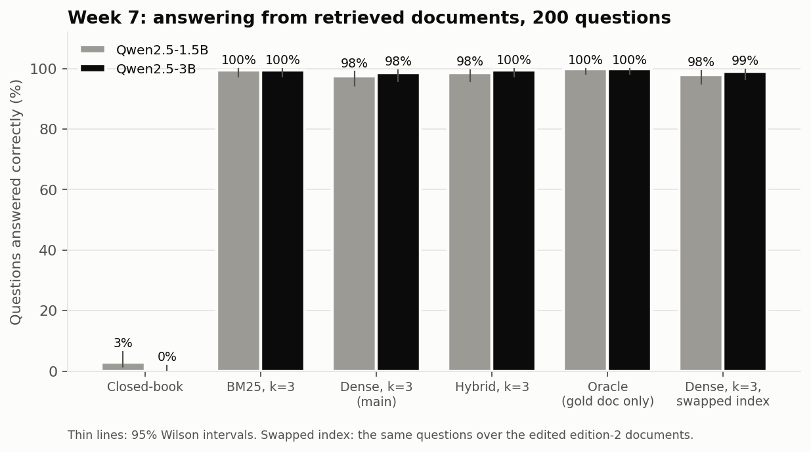
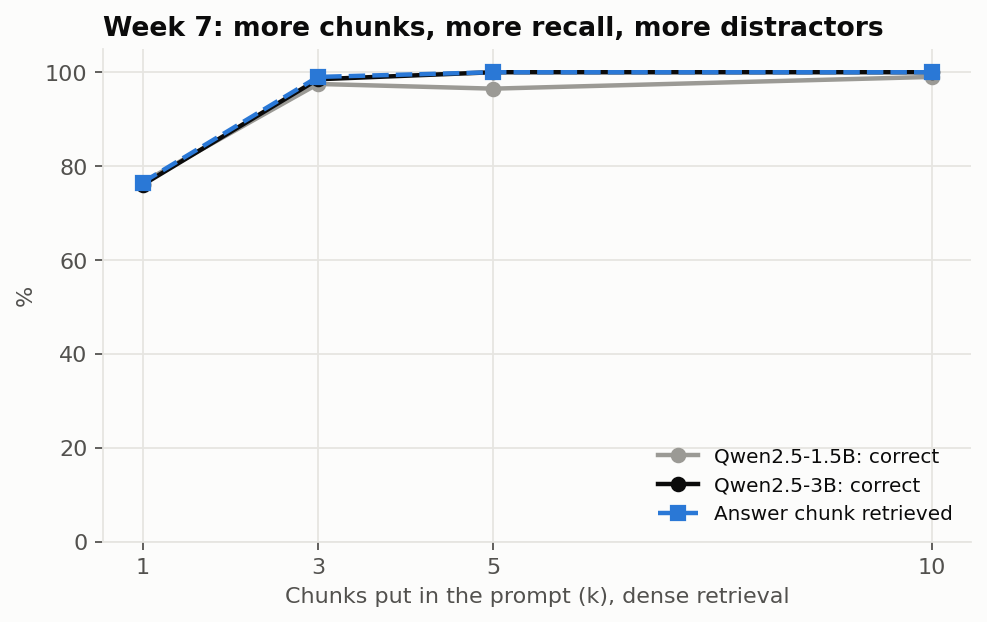
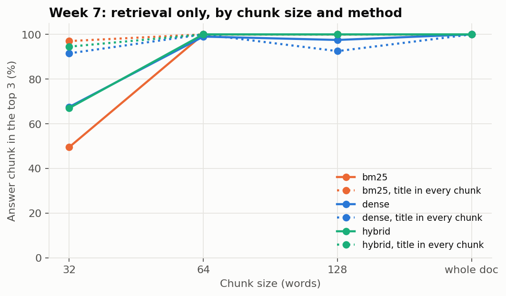
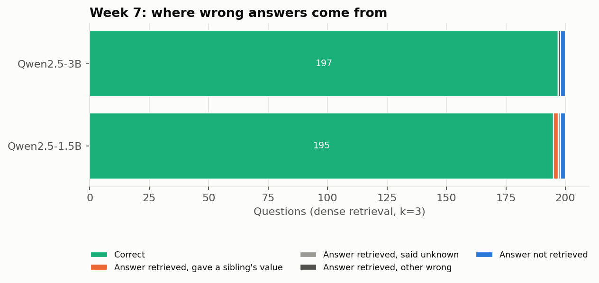

# Week 7: Retrieval-Augmented Generation Basics

**Fellow:** Joshua Obafemi · **Full repo:** [AI-Engineering-Flow_Research](https://github.com/jorshimayor/AI-Engineering-Flow_Research) (notes, code, results and article plans for every week)

**Paper:** [Retrieval-Augmented Generation for Knowledge-Intensive NLP Tasks](https://arxiv.org/abs/2005.11401) (Lewis et al., 2020)
**Lab:** build a minimal RAG pipeline over a small document set.
**Code:** [`src/rag_corpus.py`](src/rag_corpus.py) (documents and questions) · [`src/rag.py`](src/rag.py) (chunking, BM25, dense embeddings, index, prompts, scoring) · [`src/run_rag_bench.py`](src/run_rag_bench.py) (runner and analysis) · [`tests/test_week7.py`](tests/test_week7.py)
**Notebook:** [`week7_rag_colab.ipynb`](week7_rag_colab.ipynb) · [open in Colab](https://colab.research.google.com/github/jorshimayor/AI-Engineering-Flow_Research/blob/main/jupyter/week7_rag_colab.ipynb) (about 30 minutes on a free T4). It walks through each step with the code, the intermediate output and the figures inline; the committed copy is the executed Colab run.

**Status:** done. Plan committed before the run; test run on a Colab T4, 13 November 2026.

## The paper in brief

| | Lewis et al. (2020) |
|---|---|
| Question | Can a generator that reads retrieved passages beat a model that has to hold every fact in its weights? |
| Method | A DPR retriever (two BERT encoders) finds the top k of 21 million 100-word Wikipedia passages; a BART generator conditions on each. RAG-Sequence uses one passage per whole answer, RAG-Token can switch passage per token, and both marginalise over the k passages. The query encoder and generator are trained together; the passage index stays fixed |
| Results | State of the art on four open-domain QA sets at the time, and answers that human raters judged more factual and specific than BART alone |
| Two claims I can test | (1) Retrieval beats closed-book on knowledge-intensive questions. (2) Swapping the index (a 2016 Wikipedia dump for a 2018 one) updates what the model knows with no retraining |
| What I change | No training: a prompted instruct model reads the top k chunks pasted into its prompt, best first. That is how most RAG systems are built today, and it is what the lab asks for |

## The pipeline

| Step | What it does |
|---|---|
| Documents | 60 product pages for fictional products: 15 brands × 4 models (for example "Corvane C-200, camera drone"), about 154 words each, in three paragraphs. Each page states 7 facts: release year, assembly town, weight, power rating, colour, list price, warranty. Every brand, town and number is made up, so a model **cannot** know them without retrieval |
| Hard part | The four models in a family share almost all their wording and differ only in the numbers. Later paragraphs say "the C-200" or "it", never the full name |
| Questions | One question per (product, fact), worded differently from the page where it reads naturally ("first come out" for "first released", "how much does it weigh" for "weighs"). **Test:** 200 questions about 12 brands (48 products). **Dev:** questions about 3 other brands, never used in the test |
| Chunking | Windows of 64 words overlapping by 16 words: 180 chunks, about 3 per page |
| Retrieval | **Dense:** [`bge-small-en-v1.5`](https://huggingface.co/BAAI/bge-small-en-v1.5) (33M parameters), [CLS] vector, cosine similarity. **Sparse:** BM25 written from scratch (k1 = 1.5, b = 0.75). **Hybrid:** reciprocal rank fusion of the two |
| Generation | Qwen2.5-1.5B-Instruct and 3B-Instruct, greedy, up to 24 new tokens. The prompt lists the k chunks as `[1] … [2] …`, then the question, and asks for the bare answer or `unknown` |
| Scoring | Numbers are compared as numbers (`€2,339`, `2339 euros` and `2,339` all count). Colours and towns must name the right option and no other option. The product's own code is removed first, so "The C-200 weighs 16.1 kg" is read as 16.1 |

**Conditions**, the same 200 questions each:

| Condition | Context in the prompt | Role |
|---|---|---|
| `closed` | None | The model's own knowledge: should be near 0 |
| `oracle` | The whole gold page, nothing else | The ceiling: perfect retrieval |
| `dense_k3` | Top 3 chunks, dense | **The main pipeline** |
| `dense_k1`, `dense_k5`, `dense_k10` | Top 1, 5, 10 chunks, dense | How much context helps or distracts |
| `bm25_k3`, `hybrid_k3` | Top 3 chunks, BM25 or hybrid | Other retrievers |
| `swap_dense_k3` | Top 3 chunks from **edition 2** of the pages, where weight, power, colour, price and warranty all changed | The index swap: gold answers are the new values |

**Measured before the run (no model needed):** with 64-word chunks, BM25 puts the answer-bearing chunk first for 55% of test questions and in the top 3 for 100%. The product code ("C-200") is a rare, exact token, which suits BM25. How the dense retriever handles codes that differ by one digit is open.

## Plan (fixed before the test run)

**Data:** 200 test questions (fixed seed) about 48 products that no prompt or scoring work ever used. Development used the 3 dev brands only.

**Models:** Qwen2.5-1.5B-Instruct and Qwen2.5-3B-Instruct, greedy decoding. Embeddings: bge-small-en-v1.5.

| | Hypothesis | Test | Supported if |
|---|---|---|---|
| **H1** (confirmatory, Lewis et al. claim 1) | RAG answers at least 20 points more questions than closed-book, at each size | `dense_k3` vs `closed`, paired. Exact McNemar, paired bootstrap CI, Holm across the 2 models | Holm p < 0.05, CI lower bound > 0, effect ≥ 20 points |
| **H2** (confirmatory) | The retriever is not the bottleneck: `dense_k3` is within ±5 points of `oracle`, at each size | Paired bootstrap 95% CI on `dense_k3` − `oracle` | Whole CI inside ±5. Below it: retrieval or distractors cost accuracy. Above it: chunks are easier to read than whole pages |
| Exploratory | k from 1 to 10; BM25 and hybrid vs dense; the index swap (Lewis et al. claim 2), including answers that give the old value; where wrong answers come from (answer not retrieved, a sibling product's value, `unknown`, other); accuracy by fact; a retrieval-only sweep over chunk size (32, 64, 128 words, whole page), title-in-every-chunk and method | Counts, Wilson CIs, paired CIs | Reported, no significance claims |

**Dev gate** (the lesson from Week 6, where a model at its floor made a hypothesis meaningless): before the test run, 24 dev questions on the 1.5B model under `closed`, `dense_k3` and `oracle`. If `oracle` is below 50%, the test run does not start; the reason and any change go into a new commit first.

**Power:**
- **H1:** closed-book should sit near 0, so any RAG accuracy above 25% gives a McNemar p far below 0.001.
- **H2:** if RAG and oracle disagree on 5% of questions, the CI is about ±3 points and equivalence can be shown. At 10% it is about ±4.3. Beyond about 12% disagreement, equivalence can't be shown even with no real difference.

**Threats:**
- The documents are templated and uniform. Real pages vary far more in length and structure, so the absolute numbers here say little about real corpora. The comparisons between conditions are the point.
- Questions name the product exactly, which favours BM25. Real users misspell and paraphrase names.
- `oracle` passes a whole page (about 154 words) while `dense_k3` passes about 190 words of chunks. H2 compares two realistic configurations, not equal context lengths.
- The swap changes numbers only. Lewis et al. swapped whole Wikipedia dumps; here the wording stays the same, which makes the swap easier.
- One model family, one embedding model, one document type.

## Results

200 test questions, the same questions in every condition. 95% Wilson intervals. "Answer in context" = the chunk holding the answer was among those retrieved.

| Model | Condition | Correct | Said "unknown" | Gave a sibling's value | Answer in context | Prompt tokens |
|---|---|---|---|---|---|---|
| 1.5B | Closed-book | 3.0% (1.4 to 6.4) | 23.0% | 10.0% | | 61 |
| 1.5B | Oracle (gold page) | 100% (98.1 to 100) | 0% | 0% | | 293 |
| 1.5B | Dense, k = 1 | 76.5% (70.2 to 81.8) | 23.5% | 0% | 76.5% | 161 |
| 1.5B | **Dense, k = 3 (main)** | **97.5%** (94.3 to 98.9) | 1.5% | 1.0% | 99.0% | 338 |
| 1.5B | Dense, k = 5 | 96.5% (93.0 to 98.3) | 0.5% | 3.0% | 100% | 513 |
| 1.5B | Dense, k = 10 | 99.0% (96.4 to 99.7) | 0% | 1.0% | 100% | 955 |
| 1.5B | BM25, k = 3 | 99.5% (97.2 to 99.9) | 0.5% | 0% | 100% | 338 |
| 1.5B | Hybrid, k = 3 | 98.5% (95.7 to 99.5) | 0.5% | 1.0% | 100% | 338 |
| 1.5B | Swapped index, k = 3 | 98.0% (95.0 to 99.2) | 2.0% | 0% | 99.0% | 337 |
| 3B | Closed-book | 0% (0 to 1.9) | 82.0% | 0% | | 61 |
| 3B | Oracle (gold page) | 100% (98.1 to 100) | 0% | 0% | | 293 |
| 3B | Dense, k = 1 | 76.0% (69.6 to 81.4) | 23.5% | 0% | 76.5% | 161 |
| 3B | **Dense, k = 3 (main)** | **98.5%** (95.7 to 99.5) | 1.0% | 0% | 99.0% | 338 |
| 3B | Dense, k = 5 | 100% (98.1 to 100) | 0% | 0% | 100% | 513 |
| 3B | Dense, k = 10 | 100% (98.1 to 100) | 0% | 0% | 100% | 955 |
| 3B | BM25, k = 3 | 99.5% (97.2 to 99.9) | 0% | 0% | 100% | 338 |
| 3B | Hybrid, k = 3 | 99.5% (97.2 to 99.9) | 0% | 0% | 100% | 338 |
| 3B | Swapped index, k = 3 | 99.0% (96.4 to 99.7) | 1.0% | 0% | 99.0% | 337 |

The dev gate passed before the test run: oracle 24 of 24, dense k = 3 23 of 24, closed-book 2 of 24.

### Confirmatory

| | Model | Difference (95% CI) | Discordant pairs | Holm p | Verdict |
|---|---|---|---|---|---|
| **H1:** RAG − closed-book | 1.5B | +94.5 (+91.0 to +97.5) | 189 vs 0 | 2.5 × 10⁻⁵⁷ | **Supported** |
| | 3B | +98.5 (+96.5 to +100.0) | 197 vs 0 | 2.0 × 10⁻⁵⁹ | **Supported** |
| **H2:** RAG − oracle | 1.5B | −2.5 (−5.0 to −0.5) | 0 vs 5 | | **Inconclusive**: the lower bound sits exactly on −5 |
| | 3B | −1.5 (−3.5 to 0.0) | 0 vs 3 | | **Equivalent** |

**H1** holds by a wide margin, as expected: the facts are invented, so without retrieval there is nothing to recall. It reproduces Lewis et al.'s first claim in the form that matters for a small model: retrieval turns a question it cannot answer into one it almost always can.

**H2** holds at 3B and misses by the width of a rounding step at 1.5B. The rule asked for the whole interval inside ±5; the bootstrap lower bound came out at exactly −5.0. RAG never got a question right that the oracle missed (0 against 5 and 0 against 3), so retrieval only ever costs accuracy, and it cost 2.5 and 1.5 points. The bigger caveat is the ceiling: the oracle scored 100% on both models, so this task is too easy to show how much a weaker retriever would cost on harder reading.

### Exploratory (no significance claims)

1. **With no documents, the 1.5B model makes things up; the 3B model mostly says it doesn't know.** Closed-book, the 1.5B model gave a value for 154 of 200 questions ("Black", "1957", "Lowther, North Yorkshire, England"). Its 6 correct answers were all "12 months" for a warranty, a common default rather than knowledge. The 3B model said "unknown" for 82% and answered only years and power ratings, none correctly.
2. **With documents, neither model guessed when the answer was missing.** At k = 1, the retrieved chunk lacked the answer for 47 questions. Both models said "unknown" for all 47 and answered every other question correctly but one. At k = 1, accuracy is retrieval accuracy.
3. **Those 47 misses are all colour and power-rating questions.** Both facts sit in the middle chunk of each page, together with the weight. Weight questions found that chunk 30 times out of 30; colour questions found it once in 28 and power questions 10 times in 30. For all 47, the top chunk came from the right page, just the wrong part of it. My guess: "What colour is the X *sold* in?" matches the price paragraph ("sells the X at…"), and question wording pulls the retriever towards whichever chunk shares its words. Two of the colour questions still missed at k = 3, which is most of the main pipeline's errors.
4. **k = 3 is enough.** Accuracy jumps 21 to 23 points from k = 1 to k = 3, then stays within 1.5 points up to k = 10, which costs 2.8 times the prompt tokens and generation time. At 1.5B, k = 5 gave a sibling product's value 6 times (vs 2 at k = 3), each time with the right chunk ranked first: more chunks from the same family, more chances to read the wrong one. The 3B model made no sibling errors at any k.
5. **Retriever choice barely mattered here.** BM25, hybrid and dense were within 2 points at k = 3 for both models.
6. **Dense retrieval handled the product codes better than I expected.** The plan expected codes such as "C-200" to favour BM25. In the retrieval-only sweep (64-word chunks), dense put the answer chunk first for 76% of questions against 55% for BM25. BM25 catches up by the top 3 (100% vs 99%). Its weakness is that all three chunks of a page share the code, so it cannot tell which one holds the fact.
7. **Putting the page title in every chunk helps small chunks most.** At 32 words, the title lifts hit@3 from 50% to 97% (BM25) and from 68% to 92% (dense). At 64 words it lifts dense hit@1 from 76% to 90%. At 128 words it lowered dense hit@3 from 98% to 92%, a result I can't yet explain. Whole pages were found every time, but with only 60 pages that is no surprise.
8. **The index swap worked (Lewis et al.'s second claim).** With edition 2 in the index, both models gave the new values (98.0% and 99.0%) and never the old ones. The swap is easy by construction: the wording stays the same and the model has no prior for invented facts to fight.
9. **The remaining main-pipeline errors** (5 at 1.5B, 3 at 3B): 4 colour questions whose middle chunk was not retrieved; 2 sibling values at 1.5B (a town, a weight) with the right chunk first; one "unknown" at 1.5B when the answer chunk was third; one misread price at 3B ("€2,099" answered as €2999).

### Caveats

- The task sits at a ceiling: the oracle scored 100% on both models, so the reader was never the bottleneck. Templated pages and exact product names make the questions easier than real ones.
- H2 at 1.5B fails on the strict reading of the rule, at the boundary. A larger test set would settle it; at these error rates, 400 questions would give an interval about ±2 points wide.
- One embedding model, one model family, greedy decoding, 200 questions, one document type.

### What would make Week 8's eval set harder

- Questions that misspell or paraphrase product names ("the Corvane two-hundred", "the C200").
- Questions that need two facts from different chunks ("which is heavier, the C-200 or the C-300?").
- Pages that disagree (old and new editions in one index), so the model has to pick the right one.
- Real documents with uneven structure.

## Files

| File | What |
|---|---|
| [`src/rag_corpus.py`](src/rag_corpus.py) | The 60 product pages (two editions) and the questions |
| [`src/rag.py`](src/rag.py) | Chunking, BM25, dense embedder, index, prompts, answer scoring |
| [`src/run_rag_bench.py`](src/run_rag_bench.py) | Runs every condition, the retrieval sweep, and the analysis |
| [`tests/test_week7.py`](tests/test_week7.py) | Model-free checks, including a full run with a fake model |
| [`jupyter/week7_rag_colab.ipynb`](week7_rag_colab.ipynb) | The Colab walkthrough, executed on the test run |
| [`results/week7/`](results/) | 3,600 answers (2 models × 9 conditions × 200), retrieval sweep, dev gate |
| [`articles/`](https://github.com/jorshimayor/AI-Engineering-Flow_Research/tree/main/notes/week_7/articles) | Article plans |
| [`resources.md`](https://github.com/jorshimayor/AI-Engineering-Flow_Research/blob/main/notes/week_7/resources.md) | Reading list |
